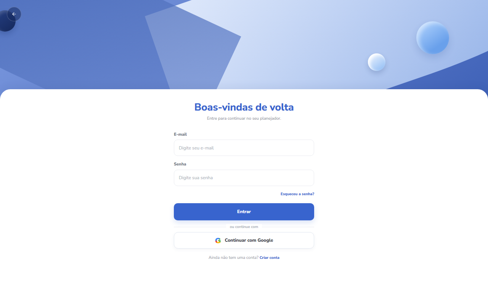
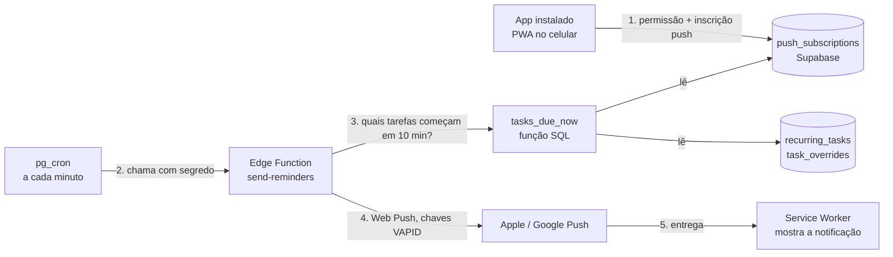

<div align="center">

# Organization Day

**Seu dia, em boa ordem.** Planejador semanal de tarefas que avisa no celular antes de cada compromisso.

[](https://organization-day.vercel.app)




</div>

## O que é

Organization Day é um app de rotina pessoal. Você monta a agenda de cada dia da semana e escolhe, tarefa por tarefa, se ela **repete toda semana** ou vale **só para aquele dia**. Instalado na tela inicial do celular (PWA), ele manda uma **notificação push 10 minutos antes** de cada tarefa, mesmo com o app fechado.

Foi criado para uso próprio e evoluído como projeto de estudo de ponta a ponta: front-end, banco, autenticação, agendamento no servidor e Web Push.

## Funcionalidades

- **Agenda por dia e por semana:** navegue entre os dias e as semanas, cada data tem a sua agenda.
- **Tarefas recorrentes e avulsas:** crie com nome, descrição e horário; escolha "só hoje" ou "toda semana". Editar, pular e excluir respeitam essa escolha.
- **Conclusão por dia:** marque uma tarefa como concluída em uma data sem afetar as outras semanas.
- **Contas:** cadastro e login por e-mail e senha, recuperação de senha e perfil com nome de exibição editável.
- **Login com Google:** entre ou crie a conta com um toque, via OAuth do Supabase. O nome vem do perfil Google.
- **Notificações push no celular:** aviso 10 minutos antes de cada tarefa, calculado no fuso horário do aparelho (funciona também se você viajar).
- **PWA:** instalável no iPhone e no Android, abre em tela cheia.
- **Dados isolados por usuário:** Row Level Security no Postgres, cada pessoa só enxerga as próprias tarefas.

## Como as notificações funcionam

O ponto mais interessante do projeto: o aviso chega sem o app aberto, vindo do servidor.



1. O app pede permissão e grava a **inscrição push** do aparelho, junto com o **fuso horário**.
2. O **pg_cron** chama a Edge Function a cada minuto, autenticada por um segredo guardado no Vault.
3. A função SQL `tasks_due_now` junta as tarefas recorrentes e as avulsas do dia (respeitando as puladas e as editadas) e devolve as que começam em 10 minutos, na hora local de cada inscrição.
4. A Edge Function envia o push com `web-push` e chaves **VAPID**, e limpa inscrições que o serviço de push informa como inválidas.
5. O **service worker** recebe o push e exibe a notificação.

> No iOS, o push só funciona com o app **instalado na Tela de Início** (iOS 16.4 ou mais novo).

## Stack

| Camada | Tecnologias |
|---|---|
| Front-end | React 19, TypeScript, Vite, React Router 7 |
| Estilo e UI | Tailwind CSS 4, componentes shadcn/Radix, lucide-react |
| Back-end | Supabase: Postgres (RLS), Auth, Edge Functions (Deno), pg_cron, pg_net, Vault |
| Notificações | Web Push (VAPID), Service Worker, `web-push` |
| Qualidade | Oxlint, `tsc` estrito |
| Hospedagem | Vercel (front) e Supabase (banco e funções) |

## Rodando localmente

Pré-requisitos: Node 20.19 ou mais novo (ou 22.12+) e um projeto no [Supabase](https://supabase.com).

```bash
git clone https://github.com/IcaroNogueiraDev/organization-day.git
cd organization-day
npm install
cp .env.example .env   # preencha as variáveis abaixo
npm run dev            # http://localhost:3000
```

Comandos úteis:

```bash
npm run lint     # oxlint
npm run build    # tsc -b && vite build
npm run preview  # serve o build
```

### Variáveis de ambiente

| Variável | Para que serve |
|---|---|
| `VITE_SUPABASE_URL` | URL do projeto Supabase |
| `VITE_SUPABASE_KEY` | chave pública (anon) do Supabase |
| `VITE_VAPID_PUBLIC_KEY` | chave VAPID **pública**, usada para inscrever o aparelho no push |

> A chave anon e a chave VAPID pública são feitas para ficar no navegador. As chaves privadas (VAPID privada, service role, segredo do cron) **nunca** entram no front nem no git: ficam nos secrets do Supabase.

### Banco de dados

Os scripts em [`supabase/sql`](supabase/sql) são idempotentes e devem rodar no SQL Editor do Supabase na ordem numérica:

| Script | O que faz |
|---|---|
| `01-push-subscriptions.sql` | tabela de inscrições push, com RLS |
| `02-tasks-due-now.sql` | função que lista as tarefas a avisar (antecedência configurável) |
| `05-descricao-e-conclusoes.sql` | descrição das tarefas e conclusão por dia |
| `06-profiles.sql` | perfil do usuário preenchido por trigger |
| `07-profiles-nome.sql` | permite editar o nome de exibição (política de escrita e limite de tamanho) |

> As tabelas base (`recurring_tasks`, `task_overrides`) e a função `get_tasks_for_day` ainda não estão versionadas neste repositório. Veja o [roadmap](#roadmap).

### Notificações (Edge Function)

```bash
npx supabase login
npx supabase link --project-ref <seu-project-ref>
npx supabase secrets set VAPID_PUBLIC_KEY=... VAPID_PRIVATE_KEY=... VAPID_SUBJECT=mailto:voce@email.com CRON_SECRET=...
npx supabase functions deploy send-reminders --no-verify-jwt
```

Depois, agende a chamada a cada minuto com `pg_cron` + `pg_net`, enviando o `CRON_SECRET` no cabeçalho `x-cron-secret` (guardado no Vault). A função só aceita chamadas com esse segredo.

## Estrutura

```
src/
├── pages/            # Boas-vindas, Entrar, Cadastro, Esqueci/Nova senha, Agenda
├── components/
│   ├── agenda/       # TaskCard, TaskDialog, WeekStrip, ProfileDialog, ...
│   ├── auth/         # ProtectedRoute, AuthShell
│   ├── ui/           # botão, card, dialog, input, checkbox (shadcn/Radix)
│   └── user/         # NotificationSection (ativar e testar lembretes)
├── hooks/
│   ├── useDailyTasks.ts    # agenda do dia, CRUD, conclusão
│   ├── useNotification.ts  # permissão e inscrição push
│   └── useAuth.ts
├── contexts/         # AuthContext (sessão Supabase)
└── lib/              # cliente Supabase, datas, erros de auth
public/
├── sw.js             # service worker (push e clique na notificação)
└── site.webmanifest  # manifest do PWA
supabase/
├── functions/send-reminders/   # Edge Function que envia os pushes
└── sql/                        # migrações do banco
```

## Decisões de projeto

- **Recorrente + exceção em vez de copiar tarefas:** uma tarefa semanal é uma linha; edições, remoções e tarefas avulsas de um dia são "overrides" por data. Assim a semana seguinte nunca precisa ser gerada.
- **Data local, não UTC:** o dia da agenda usa a data do aparelho. A comparação do lembrete também usa o fuso gravado na inscrição, então avisos e agenda sempre concordam sobre "hoje".
- **Segurança por padrão:** RLS em todas as tabelas, função de lembretes liberada só para o `service_role`, Edge Function protegida por segredo e sem segredos no repositório.
- **Erros visíveis:** falhas do Supabase viram `Error` e aparecem na tela, inclusive o estado da inscrição push, já que no iPhone não existe console.

## Roadmap

- [ ] Versionar o schema base (`recurring_tasks`, `task_overrides`, `get_tasks_for_day`) para o projeto ser reproduzível do zero
- [ ] Foto do perfil (upload no Supabase Storage)
- [ ] Nome de usuário único (@) e login por ele
- [ ] Antecedência do lembrete configurável por usuário
- [ ] Testes automatizados

## Autor

Feito por [Ícaro Nogueira](https://github.com/IcaroNogueiraDev).
